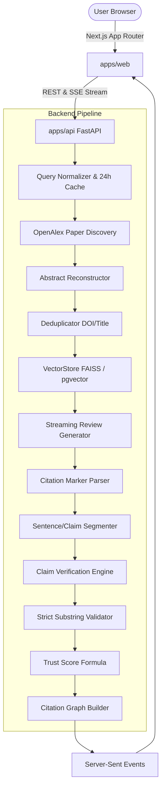

# Veritas — Citation-Verified Literature Review Generator

> **Type a research question. Get a streamed, fully cited literature review, where every claim is automatically checked against its cited paper and marked Supported, Partial or Unsupported, plus an interactive citation graph of the papers used.**

[](https://github.com/rizwandev99/Veritas-AnswerThis/actions)
[](LICENSE)
[](https://www.python.org/)
[](https://nextjs.org/)
[](https://tailwindcss.com/)

---

## 1. Why Veritas Exists (The AnswerThis Showcase)

AI-generated research reviews suffer from a critical trust problem: **hallucinated, misattributed, or exaggerated citations**. 

Veritas solves this with **claim-level citation verification**. Every factual sentence generated by the model is parsed, cited source markers are resolved, and the claim is verified against the cited paper's abstract. Each claim receives a visible verification badge (**Supported**, **Partial**, or **Unsupported**), backed by verbatim quotes and an interactive citation topology graph.

---

## 2. Architecture & Pipeline



### Pipeline Flow:
1. **Query Ingestion & Normalization**: User query is normalized; identical queries within 24 hours return cached reviews.
2. **Paper Discovery & Abstract Reconstruction**: OpenAlex REST API queries candidate papers with polite pool headers; inverted index abstracts are reconstructed.
3. **Deduplication & Vector Ranking**: Candidates deduplicated by DOI and title; top 12 embedded and ranked via `VectorStore`.
4. **Grounded Streaming Generation**: Synthesizes a structured review (400-700 words) strictly citing sources `[1]..[N]` streamed over SSE.
5. **Sentence & Claim Segmentation**: Splits output into sentences; parses citation markers (`[1]`, `[1][2]`, `[1-3]`); flags uncited factual sentences and invalid markers.
6. **Concurrent Claim Verification**: Audits each claim against source abstracts with strict quote substring verification.
7. **Trust Score Calculation**: Computes mathematical score: $\text{Trust Score} = \frac{S + 0.5 \cdot P}{V} \times 100\%$.
8. **Interactive Citation Graph**: Generates node-link topology reflecting cross-paper citations and claim verification rates.

---

## 3. How Verification Works (and its Limits)

- **Honesty Rule**: Verification is performed against **abstracts** (available text), not full papers, as explicitly noted in the UI tooltip.
- **Strict Grounding**: Any extracted evidence quote must be an exact substring of the cited source abstract. Fabricated quotes are rejected.
- **Verdict Hierarchy**:
  - `Supported`: The claim is directly entails by the source text ($>85\%$ confidence).
  - `Partial`: Context-dependent or partially entailed statement ($50\% - 85\%$).
  - `Unsupported`: The claim is not found or contradicted by the cited abstract.
  - `Invalid Citation`: Citation marker points to a source number outside $1..N$.

---

## 4. Mapping Features to AnswerThis Job Description

| AnswerThis Requirement | Veritas Implementation | PRD Milestone |
|---|---|---|
| **Next.js, React, Tailwind CSS** | `apps/web` App Router, React 19, Linear-grade design tokens (Dark/Light CSS variables), `/design` gallery route, responsive 2-column layout. | **F0, F2** |
| **Python & FastAPI** | `apps/api` async FastAPI backend, Pydantic v2 domain schemas, structured JSON logging with correlation IDs. | **F0, F1** |
| **PostgreSQL & Vector Search** | PostgreSQL 16 with `pgvector` extension; abstract `VectorStore` interface with `FaissVectorStore` and `PgVectorStore`. | **F0, F1** |
| **RAG & Citation Mapping** | Sentence-aware chunking, dense vector retrieval, and interactive citation network graph (`GET /api/reviews/{id}/graph`). | **F1, F4** |
| **Streaming UI / UX** | Server-Sent Events (`GET /api/reviews/{id}/stream`), animated progress stepper, interactive citation chips, Evidence Drawer. | **F2, F3** |
| **Docker & CI/CD** | `docker-compose.yml` (web, api, postgres), GitHub Actions workflow running lint, type checks, and tests on push/PR. | **F0** |
| **Academic Workflows** | BibTeX export with LaTeX character escaping, Markdown export, OpenAlex polite pool integration. | **F5** |

---

## 5. Quickstart & Local Setup

### Prerequisites
- Node.js 18+ & npm
- Python 3.12+
- Docker & Docker Compose (optional for local non-containerized dev)

### Option A: Docker Compose
```bash
docker compose up --build
```
- Web Application: `http://localhost:3000`
- API Health Probe: `http://localhost:8000/api/health`
- Design Gallery: `http://localhost:3000/design`

### Option B: Local Non-Containerized Dev
```bash
# Install dependencies
make install

# Run backend
cd apps/api && python -m uvicorn app.main:app --port 8000 --reload

# Run frontend (in another terminal)
cd apps/web && npm run dev
```

---

## 6. Testing & Evaluation Suite

Veritas was built following strict **Test-Driven Development (TDD)** across a 4-tier testing hierarchy:

```bash
# Run all backend unit and integration tests
make test-api

# Run E2E test suites (Tier 1 Features, Tier 2 Boundaries, Tier 3 Pairwise, Tier 4 Real-World)
make test-e2e

# Run Claim Verification Benchmark (10-pair gold standard fixtures)
make eval

# Run post-deploy smoke tests
make smoke
```

---

## 7. License

MIT © Veritas Team
