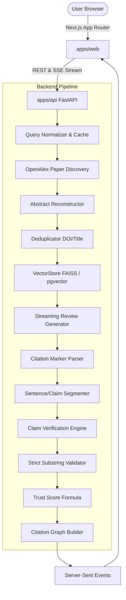

# Veritas System Architecture

Veritas is an end-to-end citation-verified literature review generator engineered as a showcase for AnswerThis.

## Core Modules & Responsibilities

1. **Frontend (`apps/web`)**: Next.js 14 App Router with React 19, Tailwind CSS, Linear-grade design tokens (Dark/Light mode via CSS variables), responsive two-column layout, SSE stream consumer, Evidence Panel, interactive Citation Graph canvas, and `/design` component gallery.
2. **Backend (`apps/api`)**: Python 3.12, FastAPI, async lifespan, structured JSON logging, sliding-window rate limiting.
3. **Paper Discovery (`app/services/paper_source.py`)**: OpenAlex REST API with polite pool email headers, abstract reconstruction from inverted index, and retry with exponential backoff.
4. **Deduplication (`app/services/dedup.py`)**: Two-pass deduplication by DOI then normalized title, retaining the highest citation count.
5. **Vector Search (`app/services/vector_store.py`)**: Abstract `VectorStore` interface with `FaissVectorStore` and `PgVectorStore`.
6. **Streaming Generator (`app/services/llm_client.py`)**: Grounded prompt engineering supplying numbered sources `[1]..[N]` in untrusted delimiters, streaming via SSE.
7. **Citation Parser (`app/services/citation_parser.py`)**: Extracts citation markers (`[1]`, `[1][2]`, `[1, 2]`, `[1-3]`), bounds checking against candidate papers, and uncited factual detection.
8. **Claim Verification Engine (`app/services/verifier.py`)**: Bounded semaphore concurrency, exact evidence quote substring verification against source abstracts, verdict hierarchy aggregation, and trust score computation.
9. **Citation Graph (`app/services/graph.py`)**: In-memory topological network builder constructing directed edges from `referenced_work_ids` with log-scaled radii and verification color mapping.
10. **Export Engine (`app/services/export.py`)**: BibTeX generation with LaTeX character escaping and Markdown export.
